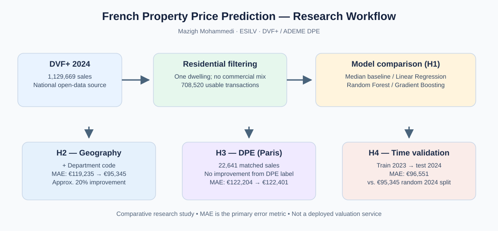

# Predicting Residential Property Prices in France with Machine Learning

**Mazigh Mohammedi** · MSc Data Science & Computer Science · ESILV (2026)  
**Research project:** Geographic, Energy and Temporal Effects on Residential Property Value Prediction

> **Main finding:** In this study, adding **department-level geographic information** to Gradient Boosting reduced the national Mean Absolute Error (MAE) from **€119,235 to €95,345**, approximately a **20% improvement**. Richer information mattered more than simply increasing model complexity.

## Research question

**Which machine-learning approach best predicts residential property sale prices in France using open data?**

This project is a comparative experimental study. It evaluates how the choice of ML algorithm, geography, energy-performance labels (DPE) and out-of-time testing affect prediction accuracy. **It is not a deployed property-valuation web application.**

## Research workflow



## Data

- **DVF+ (Cerema):** residential sales across France, with **708,520 usable transactions from 2024**, filtered from 1,129,669 sales.
- **DPE (ADEME):** energy-performance certificates for a Paris subset; **22,641 DVF+ transactions matched to DPE** using proximity (≤ 50 m), certificate date not later than the sale and dwelling-surface deviation ≤ 10%.
- Features include surface, room count, property type, land surface, outbuildings and department.

Raw national datasets are **not included** because of their size. See the research paper for the selection and matching protocol.

## Experimental results

### H1 — Compare regression models

National 2024 sample with **physical features only**:

| Model | MAE (€) | RMSE (€) | R² |
|:--|--:|--:|--:|
| Gradient Boosting | **119,235** | 279,881 | 0.083 |
| Linear Regression | 124,345 | **266,822** | **0.166** |
| Random Forest | 128,168 | 288,355 | 0.026 |
| Naive median baseline | 128,936 | 297,877 | -0.039 |

**Finding:** Gradient Boosting leads on MAE but not on RMSE or R². H1 is partially supported.

### H2 — Add geography

| Gradient Boosting configuration | MAE (€) | R² |
|:--|--:|--:|
| Physical features only | 119,235 | 0.083 |
| + Department code | **95,345** | **0.421** |

**Finding:** Adding department geography reduces MAE by approximately €23,890 (20%). H2 is supported.

### H3 — Does the DPE label improve prediction?

A **controlled ablation study** compares identical Gradient Boosting configurations on the same **22,641 matched Paris transactions**:

| Configuration | MAE (€) | R² |
|:--|--:|--:|
| Without DPE label | **122,204** | **0.770** |
| With DPE label | 122,401 | 0.766 |

**Finding:** The DPE label did not improve this model on this specific matched Paris subset. This is **not** evidence that energy performance has no influence on sale prices. H3 is not supported.

### H4 — Temporal validation

| Evaluation setup | MAE (€) | R² |
|:--|--:|--:|
| Random train/test split within 2024 | **95,345** | **0.421** |
| Train on 2023 → test on 2024 | 96,551 | 0.409 |

**Finding:** Results degrade modestly when predicting a later year. H4 is moderately supported.

### Feature importance

For the best national Gradient Boosting configuration, **living area (48.71%)** and **department (44.86%)** account for **93.57%** of aggregated feature importance. These are model importances, **not causal effects**.

## Repository contents

```text
.
├── notebooks/
│   └── 02_dvfplus_preparation.ipynb   # full exploration and experiments
├── reports/
│   ├── importance_variables.csv
│   ├── resultats_h3_dpe.csv
│   ├── resultats_h4_temporel.csv
│   ├── resultats_modeles_france.csv
│   └── synthese_hypotheses.csv
├── docs/
│   ├── research_paper.pdf             # six-page research paper
│   └── workflow.svg                   # research pipeline diagram
├── requirements.txt
├── .gitignore
└── README.md
```

## Reproducibility

The [notebook](notebooks/02_dvfplus_preparation.ipynb) documents the original exploratory workflow and experiments; the CSV files in [reports](reports/) provide exported results. The notebook depends on **external DVF+ / ADEME data**, with file paths specific to the original working environment, and is **not plug-and-play from a fresh clone**.

Key Python libraries: Pandas, NumPy, scikit-learn, GeoPandas, Matplotlib, Requests and data-format drivers (see [requirements.txt](requirements.txt)).

1. Download the required DVF+ departmental files from [Cerema Datafoncier](https://datafoncier.cerema.fr/donnees/autres-donnees-foncieres/dvfplus-open-data).
2. Consult ADEME's [DPE open dataset](https://data.ademe.fr/datasets/dpe03existant) for the Paris matching experiment.
3. Adapt the relative input/output paths in the notebook to your local directories and set up an appropriate Python environment.
4. Execute notebook cells in order, respecting the extensive data download, preprocessing and matching steps.

## Limitations

The national model uses only coarse geographic information (department, not neighborhood), and its best MAE (€95,345) is too high to substitute for an individual professional appraisal. DPE matching is approximate and specific to the Paris subset. Only one 2023→2024 temporal transition was tested. Limited model tuning was intentional: this project emphasizes controlled comparisons and feature contribution.

## Read the research paper

[**Machine Learning for Residential Property Value Prediction in the French Real Estate Market: Geographic, Energy, and Temporal Effects (PDF)**](docs/research_paper.pdf)

**Author:** Mazigh Mohammedi · ESILV, MSc Data Science & Computer Science.
